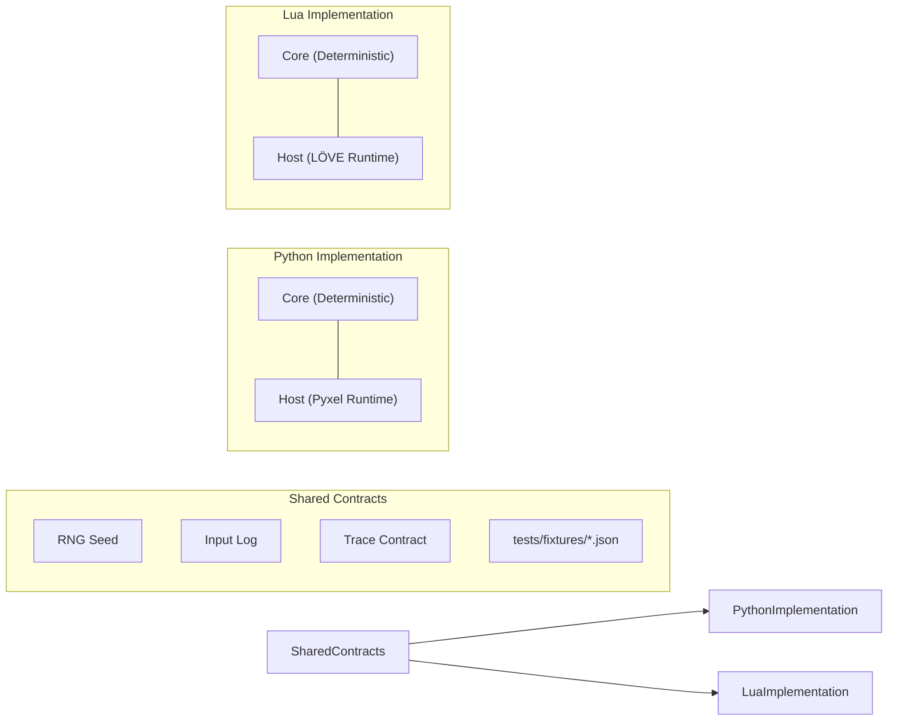

# NightEngine Documentation

NightEngine is the Nightcircle game engine for Python/Pyxel and Lua/LÖVE.
Both implementations share deterministic frame, input, RNG, replay and trace contracts.

---

## Documentation Map

This directory is the single source of truth for engine architecture, contracts, targets, and developer workflows.

### 1. Architecture & Contracts
- **[Architecture](architecture.md)** — Core versus host separation, simulation loop (`Game.step`), and game integration model.
- **[Compatibility](compatibility.md)** — Deterministic parity contracts, input encoding, replay format, and shared verification fixtures.

### 2. Implementations & Targets
- **[Python / Pyxel](python-pyxel.md)** — Python engine core, Pyxel host setup, desktop packaging, web (Wasm), and Android builds.
- **[Lua / LÖVE](lua-love.md)** — Lua package layout, LÖVE 11.5 host setup, desktop fusion builds, and mobile targets.

### 3. APIs & Tooling
- **[Nightrunner APIs](nightrunner-api.md)** — Bindings, event bus, save storage, audio cues, and fixed time-step pacing.
- **[Observability](observability.md)** — `app.dev` debugging controls, snapshot callbacks, and the `love2d-mcp` development bridge.

### 4. Repository Rules & Process
- **[Engine Rules](repo/engine-rules.md)** — Determinism invariants, core boundaries, and breaking change rules.
- **[Workflow](repo/workflow.md)** — Branching model, pre-commit checks, CI matrix, release procedure, and execution plans.
- **[Active Execution Plans](exec-plans/active/README.md)** — Roadmap and in-flight architecture refactors.

---

## Core Principles

1. **Deterministic Parity**: Python and Lua cores implement the exact same behavior and pass the exact same fixtures in `tests/fixtures/`.
2. **Runtime Independence**: Cores never import their host runtime (`pyxel` or `love`). All runtime dependencies remain inside `host/`.
3. **Paired Evolution**: Any interface change touches both implementations simultaneously.
