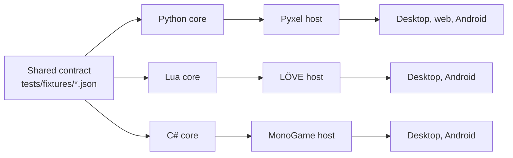

# NightEngine

NightEngine is the Nightcircle game engine. It runs games on three runtimes:
Python/Pyxel, Lua/LÖVE and C#/MonoGame. All three share deterministic frame,
input, RNG, replay and trace contracts. A game is a thin layer of data, rules,
scenes, art and sound on top.

Read the [Vision](vision.md) first. The [Roadmap](roadmap.md) lists what is not done yet.

## I make a game

1. [Choose a runtime](concepts/runtimes.md) and check [Platforms](concepts/platforms.md).
2. [Use the engine in a game](games/consume.md): add the submodule and pin it.
3. Follow the [Game layout](games/layout.md) and set the [Game configuration](games/configuration.md).
4. Use the standard [Game commands](games/commands.md).
5. Link the [Agent skills](games/skills.md).
6. Read your runtime page: [Python/Pyxel](runtimes/python-pyxel.md),
   [Lua/LÖVE](runtimes/lua-love.md) or [C#/MonoGame](runtimes/csharp-monogame.md).

## I change the engine

1. Read [Architecture](concepts/architecture.md) and the [Contract](concepts/contract.md).
2. Follow the [Engine rules](repo/engine-rules.md) and the [Workflow](repo/workflow.md).
3. Keep the [Layers and parity](concepts/layers.md) manifest and the docs true. See [Documentation](repo/docs.md).
4. Put multi-step work in an [execution plan](exec-plans/active/README.md).

## Reference

- [Observability](reference/observability.md): `app.dev` controls and the MCP bridges.
- [Nightrunner APIs](reference/nightrunner-api.md): bindings, events, storage and pacing.
